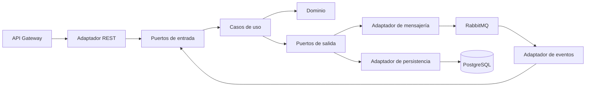

# RST-ItemCatalog-Service

[](https://github.com/StyleRadar1/RST-ItemCatalog-Service/actions/workflows/ci.yml)

## 1. Servicio y bounded context

**ms-item-catalogo**: microservicio de gestión, búsqueda y moderación de prendas de StyleRadar.

Su responsabilidad dentro de la plataforma es: publicación, búsqueda, filtrado y moderación de las prendas del catálogo. Forma parte del Paquete 2 Catálogo y atiende en el puerto `8085`.

## 2. Equipo y responsables

Equipo Restrepo (prefijo `RST`).

- Daniel Mosquera (Backend)
- Sebastián Camilo Granados (Backend)
- Carlos Sánchez (Frontend)
- Juan Nicolás Álvarez Muñoz (Líder y apoyo)

## 3. Arquitectura hexagonal

El servicio sigue la arquitectura hexagonal acordada por el curso. Las reglas del negocio se mantienen aisladas de las herramientas externas, como la base de datos, el broker de mensajería o la API REST, de modo que estas pueden cambiar sin afectar la lógica principal.



## 4. Endpoints y Swagger

| Método | Ruta | Descripción |
|---|---|---|
| GET | `/api/v1/health` | Estado del servicio |

La documentación de la API está disponible en `/api/v1/swagger-ui.html`.

Funcionalidades que cubrirá el servicio:

| Requerimiento | Funcionalidad |
|---|---|
| SR-RF-07 | Buscar prendas mediante texto libre |
| SR-RF-08 a SR-RF-13 | Filtrar prendas por tipo, color, talla, precio, marca y estilo |
| SR-RF-14 y SR-RF-15 | Ordenar resultados por distancia y por reputación del almacén |
| SR-RF-16 | Consultar prendas similares cuando no exista coincidencia exacta |
| SR-RF-19, SR-RF-20 y SR-RF-22 | Catálogo resumido, novedades semanales y catálogo de almacén |
| SR-RF-50, SR-RF-51, SR-RF-53 a SR-RF-55 y SR-RF-58 | Publicar, editar y retirar prendas |
| SR-RF-61 y SR-RF-87 | Moderar publicaciones del catálogo |

## 5. Eventos que publica y consume

**Publica**

| Evento | Consumidores | Propósito |
|---|---|---|
| `NuevaPrendaCreadaEvent` | ms-notificaciones | Se publicó una prenda nueva en el catálogo. |

**Consume**

| Evento | Productor | Propósito |
|---|---|---|
| `PrendaAgotadaEvent` | ms-inventario | Marca la prenda como no disponible en los resultados. |
| `SuscripcionSuspendidaEvent` | ms-pagos-suscripciones | Deja de mostrar el catálogo del almacén suspendido. |

## 6. Tecnologías y dependencias

| Tecnología | Versión |
|---|---|
| Java | 21 |
| Spring Boot | 3.3.4 |
| PostgreSQL | 15.8 |
| RabbitMQ | 3.13.7 |
| MapStruct | 1.5.5.Final |
| springdoc-openapi | 2.6.0 |
| JaCoCo | 0.8.12 |
| SpotBugs | 4.8.6.4 |

## 7. Cómo ejecutar

El servicio, junto con su base de datos y RabbitMQ, se levanta con Docker a partir de un archivo `.env` creado desde `.env.example`:

```bash
docker compose up -d --build
```

## 8. Variables de entorno

Las variables se definen en `.env`, que no se versiona. La plantilla `.env.example` indica cuáles se requieren.

| Variable | Descripción |
|---|---|
| `SERVER_PORT` | Puerto del servicio |
| `DB_HOST`, `DB_PORT`, `DB_NAME` | Conexión a PostgreSQL |
| `DB_USER`, `DB_PASSWORD` | Credenciales de PostgreSQL |
| `RABBITMQ_HOST`, `RABBITMQ_PORT` | Conexión a RabbitMQ |
| `RABBITMQ_USER`, `RABBITMQ_PASSWORD` | Credenciales de RabbitMQ |

## 9. Pruebas y cobertura

Las pruebas unitarias validan el dominio y los casos de uso, y las de integración validan la persistencia y la mensajería. Se exige una cobertura mínima del 85 %, verificada en cada ejecución del pipeline.

## 10. CI/CD

[](https://github.com/StyleRadar1/RST-ItemCatalog-Service/actions/workflows/ci.yml)

Cada cambio enviado a `master`, `develop` o a una rama `feature/*`, así como cada pull request, pasa por un pipeline que compila el proyecto, ejecuta las pruebas, verifica la cobertura, realiza el análisis estático del código y construye la imagen Docker.

## 11. Ramas y cómo contribuir

- `master`: versiones estables.
- `develop`: integración del trabajo del equipo.
- `feature/HU-xx-descripcion`: una rama por historia de usuario, creada desde `develop`.

Los cambios llegan a `develop` y `master` únicamente por pull request, con revisión y el pipeline en verde.

## 12. Épica en Jira

[RES-2 · ms-item-catalogo](https://mail-team-nyjtgqcj.atlassian.net/browse/RES-2)
