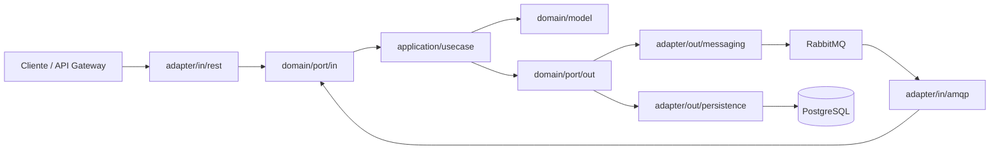

# RST-ItemCatalog-Service

[](https://github.com/StyleRadar1/RST-ItemCatalog-Service/actions/workflows/ci.yml)

## 1. Servicio y bounded context

**ms-item-catalogo** · Microservicio de gestión, búsqueda y moderación de prendas de StyleRadar.

Bounded context **Ítem Catálogo**: Publicación, búsqueda, filtrado y moderación de las prendas del catálogo.

Paquete 2 Catálogo · puerto `8085` · base de datos `styleradar_item_catalog`.

## 2. Equipo y responsables

Equipo **Restrepo** (prefijo `RST`).

- Daniel Mosquera (Backend)
- Sebastián Camilo Granados (Backend)
- Carlos Sánchez (Frontend)
- Juan Nicolás Álvarez Muñoz (Líder y apoyo)

## 3. Arquitectura hexagonal

El servicio sigue la estructura hexagonal votada por el curso. Las dependencias apuntan hacia el dominio: el dominio no conoce Spring, JPA ni HTTP; los casos de uso y servicios se definen como interfaz con su implementación `<Nombre>Impl`, y los beans se registran en `infrastructure/config/BeanConfig`.



```text
src/main/java/edu/dosw/styleradar/itemcatalogo/
├── domain/            model, event, exception, port/in, port/out
├── application/       usecase, service/impl, dto/request|response|event, mapper/in|out
└── infrastructure/    adapter/in/rest|amqp, adapter/out/persistence|messaging|security|external, config, exception
src/test/java/edu/dosw/styleradar/itemcatalogo/   espejo de main
```

## 4. Endpoints y Swagger

Base: `http://localhost:8085/api/v1`

| Método | Ruta | Descripción |
|---|---|---|
| GET | `/health` | Estado del servicio |

Swagger UI: `http://localhost:8085/api/v1/swagger-ui.html` · OpenAPI: `http://localhost:8085/api/v1/v3/api-docs`

Requerimientos que cubrirá el servicio:

| Requerimiento | Funcionalidad |
|---|---|
| SR-RF-07 | Buscar prendas mediante texto libre |
| SR-RF-08 a SR-RF-13 | Filtrar prendas por tipo, color, talla, precio, marca y estilo |
| SR-RF-14 y SR-RF-15 | Ordenar resultados por distancia y por reputación del almacén |
| SR-RF-16 | Consultar prendas similares cuando no exista coincidencia exacta |
| SR-RF-19, SR-RF-20 y SR-RF-22 | Catálogo resumido, novedades semanales y catálogo de almacén |
| SR-RF-50, SR-RF-51, SR-RF-53 a SR-RF-55 y SR-RF-58 | Publicar, editar y retirar prendas |
| SR-RF-61 y SR-RF-87 | Moderar publicaciones del catálogo |

## 5. Eventos que publica y consume

**Publica**

| Evento | Consumidores | Descripción |
|---|---|---|
| `NuevaPrendaCreadaEvent` | ms-notificaciones | Se publicó una prenda nueva en el catálogo. |

**Consume**

| Evento | Productor | Descripción |
|---|---|---|
| `PrendaAgotadaEvent` | ms-inventario | Marca la prenda como no disponible en los resultados. |
| `SuscripcionSuspendidaEvent` | ms-pagos-suscripciones | Deja de mostrar el catálogo del almacén suspendido. |

## 6. Tecnologías y dependencias

| Tecnología | Versión |
|---|---|
| Java (Eclipse Temurin) | 21 |
| Spring Boot | 3.3.4 |
| PostgreSQL | 15.8 |
| Flyway | gestionada por Spring Boot |
| RabbitMQ | 3.13.7 |
| MapStruct | 1.5.5.Final |
| springdoc-openapi | 2.6.0 |
| JUnit 5, Mockito y Testcontainers | gestionadas por Spring Boot |
| JaCoCo | 0.8.12 |
| SpotBugs | 4.8.6.4 |

## 7. Cómo ejecutar

Antes de ejecutar, copia `.env.example` a `.env` y completa `DB_PASSWORD` y `RABBITMQ_PASSWORD`.

**Local** (requiere PostgreSQL y RabbitMQ en ejecución):

```bash
cp .env.example .env
./mvnw spring-boot:run -Dspring-boot.run.profiles=dev
```

**Docker** (levanta el servicio, PostgreSQL y RabbitMQ con un solo comando):

```bash
cp .env.example .env
docker compose up -d --build
```

## 8. Variables de entorno

Los valores se definen en `.env` a partir de `.env.example`. El archivo `.env` no se versiona.

| Variable | Descripción | Valor por defecto |
|---|---|---|
| `SERVER_PORT` | Puerto HTTP | `8085` |
| `DB_HOST` | Host de PostgreSQL | `localhost` |
| `DB_PORT` | Puerto de PostgreSQL | `5432` |
| `DB_NAME` | Base de datos | `styleradar_item_catalog` |
| `DB_USER` | Usuario de PostgreSQL | `postgres` |
| `DB_PASSWORD` | Contraseña de PostgreSQL | sin valor |
| `RABBITMQ_HOST` | Host de RabbitMQ | `localhost` |
| `RABBITMQ_PORT` | Puerto de RabbitMQ | `5672` |
| `RABBITMQ_USER` | Usuario de RabbitMQ | `guest` |
| `RABBITMQ_PASSWORD` | Contraseña de RabbitMQ | sin valor |

## 9. Pruebas y cobertura

```bash
./mvnw verify
```

- Pruebas unitarias de dominio y casos de uso con JUnit 5 y Mockito en `src/test/java`, como espejo de `src/main/java`.
- Pruebas de integración de persistencia y mensajería con Testcontainers.
- Cobertura mínima del 85 % de líneas verificada por JaCoCo. Reporte en `target/site/jacoco/index.html`.

## 10. CI/CD

[](https://github.com/StyleRadar1/RST-ItemCatalog-Service/actions/workflows/ci.yml)

El flujo `.github/workflows/ci.yml` se ejecuta en cada push a `master`, `develop` y `feature/**`, y en cada pull request hacia `master` y `develop`:

1. Compilación.
2. Pruebas, cobertura con JaCoCo y análisis estático con SpotBugs (`mvn verify`).
3. Construcción de la imagen Docker.

## 11. Ramas y cómo contribuir

- `master`: versiones estables. Solo recibe cambios por pull request desde `develop`.
- `develop`: integración. Solo recibe cambios por pull request desde ramas `feature/*`.
- `feature/HU-xx-descripcion`: una rama por historia de usuario, creada desde `develop`.

No se hacen commits directos a `master` ni a `develop`. Cada pull request necesita revisión y el pipeline en verde.

## 12. Épica en Jira

[RES-2 · ms-item-catalogo](https://mail-team-nyjtgqcj.atlassian.net/browse/RES-2)
