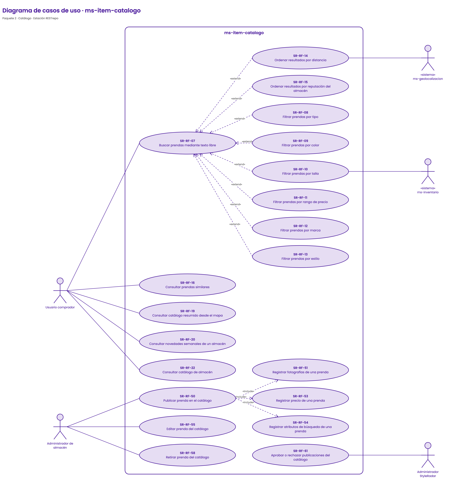
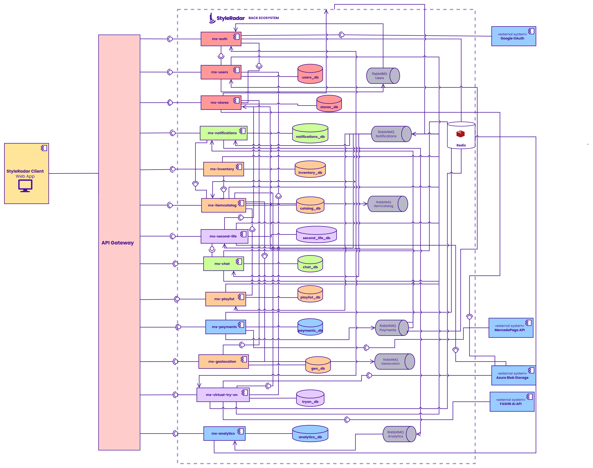
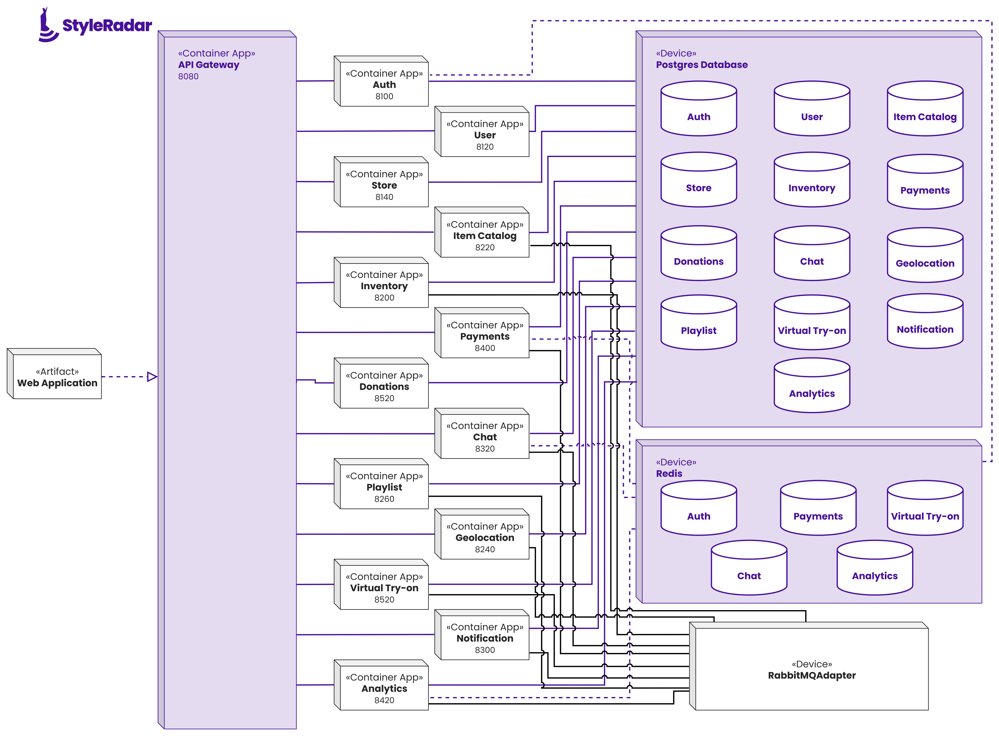
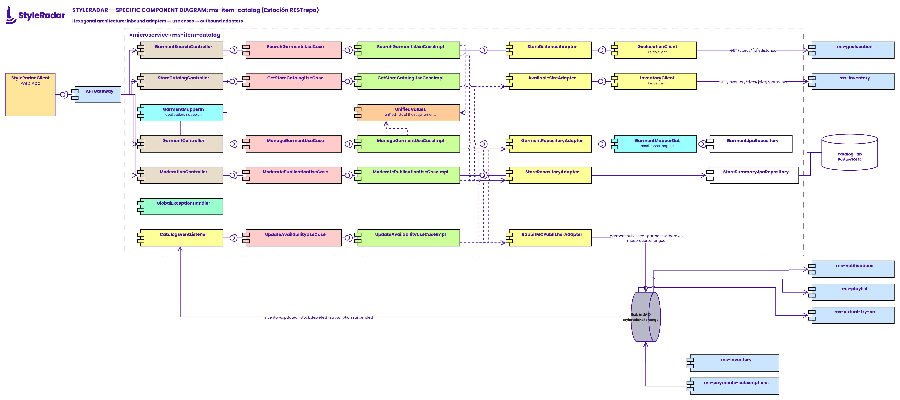
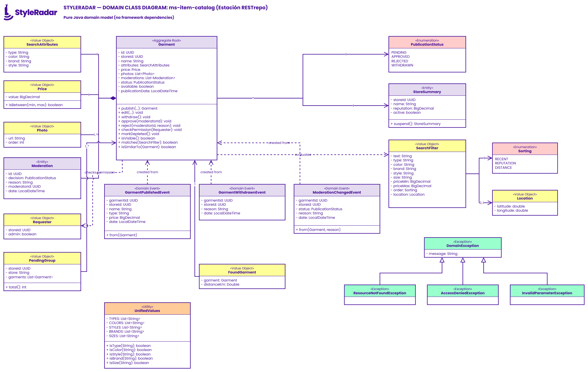
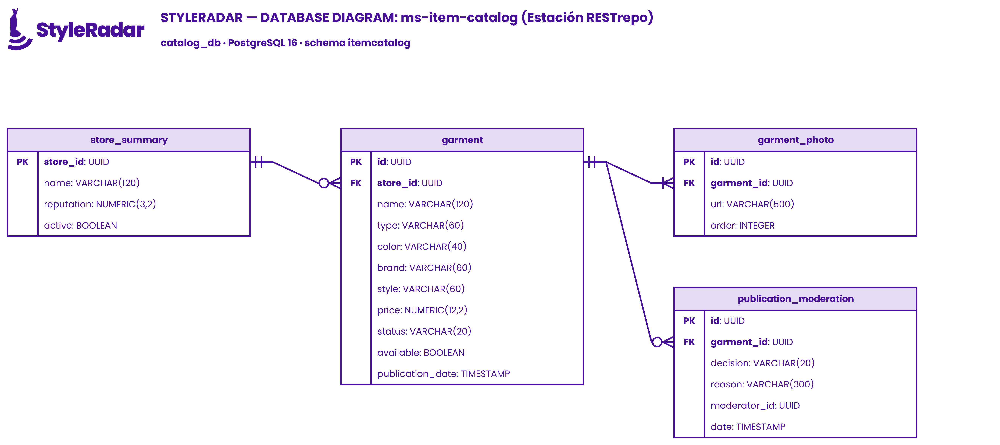
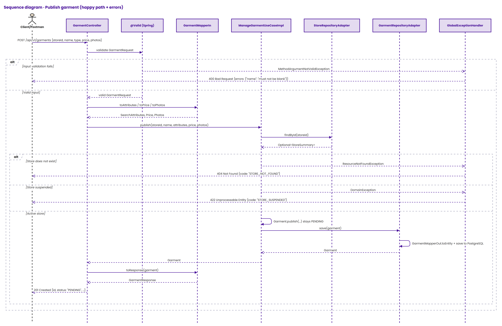
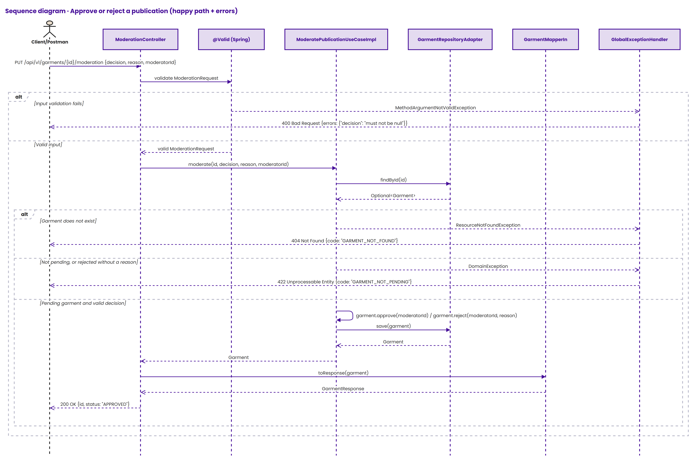

##  3. ARQUITECTURA HEXAGONAL CON SU DIAGRAMA

El servicio sigue la arquitectura hexagonal acordada por el curso. Las reglas del negocio se mantienen aisladas de las herramientas externas, como la base de datos, el broker de mensajería o la API REST, de modo que estas pueden cambiar sin afectar la lógica principal.

### Diagrama de Casos de Uso

<div align="center">
  <table width="100%" style="margin: 18px 0; border: 2px dashed #C4B5FD; border-radius: 8px; background-color: #FBFBFE;">
    <tr>
      <td align="center" style="padding: 20px;">
        <p>
          <br />
          <strong><font color="#5600EF" size="3">DIAGRAMA DE CASOS DE USO · MS-ITEM-CATALOGO</font></strong>
        </p>
        <p>
          <br />
        </p>
      </td>
    </tr>
  </table>
</div>

El usuario comprador busca prendas con texto libre (SR-RF-07). Los filtros por tipo, color, talla, precio, marca y estilo (SR-RF-08 a SR-RF-13) y los ordenamientos por distancia y por reputación (SR-RF-14 y SR-RF-15) extienden la búsqueda, porque se aplican de forma opcional sobre ella. También consulta prendas similares, el catálogo resumido desde el mapa, las novedades y el catálogo de un almacén (SR-RF-16, SR-RF-19, SR-RF-20 y SR-RF-22). El administrador de almacén publica prendas (SR-RF-50), lo que siempre incluye registrar sus fotografías, su precio y sus atributos de búsqueda (SR-RF-51, SR-RF-53 y SR-RF-54), y además edita y retira sus prendas (SR-RF-55 y SR-RF-58). El administrador StyleRadar aprueba o rechaza las publicaciones (SR-RF-61). `ms-geolocalizacion` participa como sistema externo para calcular la distancia a cada almacén y `ms-inventario` para consultar tallas y unidades. Cada caso de uso lleva el código de su requerimiento en el análisis de requerimientos, los actores usan los nombres oficiales del análisis y el rectángulo marca el límite del microservicio. El archivo editable está en `docs/evidencias/diagrama-casos-uso.drawio`.

### Diagrama de Componentes General

<div align="center">
  <table width="100%" style="margin: 18px 0; border: 2px dashed #C4B5FD; border-radius: 8px; background-color: #FBFBFE;">
    <tr>
      <td align="center" style="padding: 20px;">
        <p>
          <br />
          <strong><font color="#5600EF" size="3">DIAGRAMA DE COMPONENTES GENERAL · STYLERADAR</font></strong>
        </p>
        <p>
          <br />
        </p>
      </td>
    </tr>
  </table>
</div>

Diagrama de componentes general de StyleRadar, el mismo para todos los microservicios. El archivo editable está en `docs/evidencias/DespligueYComponentesGeneral.drawio` (página GeneralComponentDiagram).

### Diagrama de Despliegue

<div align="center">
  <table width="100%" style="margin: 18px 0; border: 2px dashed #C4B5FD; border-radius: 8px; background-color: #FBFBFE;">
    <tr>
      <td align="center" style="padding: 20px;">
        <p>
          <br />
          <strong><font color="#5600EF" size="3">DIAGRAMA DE DESPLIEGUE · STYLERADAR</font></strong>
        </p>
        <p>
          <br />
        </p>
      </td>
    </tr>
  </table>
</div>

Diagrama de despliegue general de StyleRadar, el mismo para todos los microservicios. El archivo editable está en `docs/evidencias/DespligueYComponentesGeneral.drawio` (página DeploymentDiagram).

### Diagrama de Componentes Específico

<div align="center">
  <table width="100%" style="margin: 18px 0; border: 2px dashed #C4B5FD; border-radius: 8px; background-color: #FBFBFE;">
    <tr>
      <td align="center" style="padding: 20px;">
        <p>
          <br />
          <strong><font color="#5600EF" size="3">DIAGRAMA DE COMPONENTES ESPECÍFICO (HEXAGONAL)</font></strong>
        </p>
        <p>
          <br />
        </p>
      </td>
    </tr>
  </table>
</div>

El diagrama muestra el servicio en arquitectura hexagonal. Las peticiones llegan desde el API Gateway a los controllers REST (adaptadores de entrada), que usan un mapper de entrada para convertir la petición al modelo de dominio y solo conocen la interfaz del caso de uso (puerto de entrada); los eventos de otros servicios llegan por RabbitMQ al `CatalogoEventListener`. Las implementaciones de los casos de uso (`<Nombre>Impl`) usan los puertos de salida: `PrendaRepositoryPort` para la base de datos (con un mapper de salida hacia la entidad JPA), `EventPublisherPort` para publicar `PrendaPublicadaEvent`, `PrendaRetiradaEvent` y `ModeracionCambiadaEvent` y `GeolocalizacionClientPort` para obtener distancias de `ms-geolocalizacion` al ordenar resultados (SR-RF-14) y `TallaDisponiblePort` para obtener de `ms-inventario` las prendas con unidades en la talla buscada (SR-RF-10). Los flujos cubren búsqueda y filtros (SR-RF-07 a 16), catálogo de almacén (SR-RF-19, 20 y 22), gestión de prendas (SR-RF-50 a 58), moderación (SR-RF-61 y 87) y la actualización de disponibilidad por eventos.

### Diagrama de Clases

<div align="center">
  <table width="100%" style="margin: 18px 0; border: 2px dashed #C4B5FD; border-radius: 8px; background-color: #FBFBFE;">
    <tr>
      <td align="center" style="padding: 20px;">
        <p>
          <br />
          <strong><font color="#5600EF" size="3">DIAGRAMA DE CLASES DEL DOMINIO</font></strong>
        </p>
        <p>
          <br />
        </p>
      </td>
    </tr>
  </table>
</div>

El agregado principal es `Prenda`, que agrupa sus atributos de búsqueda (tipo, color, marca y estilo), su `Precio`, sus `Fotografia` y su `EstadoPublicacion`. Los métodos del agregado cubren editar, retirar, aprobar, rechazar y marcar como agotada; cada aprobación o rechazo queda como una `Moderacion` con su motivo (SR-RF-61 y 87). `AlmacenResumen` guarda la reputación y el estado del almacén para ordenar por reputación (SR-RF-15) y ocultar los almacenes suspendidos. `FiltroBusqueda` reúne los criterios de búsqueda, incluida la talla, y el `Ordenamiento` (por distancia o reputación). Los eventos de dominio son `PrendaPublicadaEvent` (al aprobarse), `PrendaRetiradaEvent` (al retirarla) y `ModeracionCambiadaEvent` (en cada aprobación o rechazo).

### Diagrama de Base de Datos

<div align="center">
  <table width="100%" style="margin: 18px 0; border: 2px dashed #C4B5FD; border-radius: 8px; background-color: #FBFBFE;">
    <tr>
      <td align="center" style="padding: 20px;">
        <p>
          <br />
          <strong><font color="#5600EF" size="3">MODELO DE DATOS (POSTGRESQL)</font></strong>
        </p>
        <p>
          <br />
        </p>
      </td>
    </tr>
  </table>
</div>

Se usa PostgreSQL porque las prendas tienen atributos fijos sobre los que se filtra y ordena. La tabla `prenda` guarda los atributos de búsqueda, el precio, el estado de publicación y la disponibilidad; `fotografia_prenda` guarda las fotos de cada prenda y `moderacion_publicacion` el historial de aprobaciones y rechazos, ambas en relación uno a muchos con `prenda`. `almacen_resumen` es una copia local de los datos del almacén que necesita el catálogo (nombre, reputación y si está activo), alimentada por eventos, ya que los almacenes pertenecen a otro servicio (*Database-per-Service*). `prenda.disponible` y `almacen_resumen.activo` se actualizan con los eventos `PrendaAgotadaEvent` y `SuscripcionSuspendidaEvent`.

### Diagramas de Secuencia

Los diagramas muestran, para cada funcionalidad, el recorrido de la petición por las capas del servicio, tanto en el camino exitoso como en los errores. Los fragmentos `alt` separan cada caso. Los archivos editables de draw.io están junto a las imágenes en `docs/evidencias`.

<div align="center">
  <table width="100%" style="margin: 18px 0; border: 2px dashed #C4B5FD; border-radius: 8px; background-color: #FBFBFE;">
    <tr>
      <td align="center" style="padding: 20px;">
        <p>
          <br />
          <strong><font color="#5600EF" size="3">PUBLICAR PRENDA</font></strong>
        </p>
        <p>
          <br />
        </p>
      </td>
    </tr>
  </table>
</div>

Al publicar una prenda, Spring valida primero el `PrendaRequest`; si falta un dato obligatorio, `GlobalExceptionHandler` responde 400 con el campo que falló. Con la solicitud válida, el controlador convierte los datos con `PrendaMapperIn` y llama al caso de uso, que verifica que el almacén exista (si no, 404) y que no esté suspendido (si lo está, 422). Cuando todo está en orden, la prenda se crea en estado `PENDIENTE`, se guarda en PostgreSQL y se responde 201 con la prenda creada (SR-RF-50).

<div align="center">
  <table width="100%" style="margin: 18px 0; border: 2px dashed #C4B5FD; border-radius: 8px; background-color: #FBFBFE;">
    <tr>
      <td align="center" style="padding: 20px;">
        <p>
          <br />
          <strong><font color="#5600EF" size="3">APROBAR O RECHAZAR PUBLICACIÓN</font></strong>
        </p>
        <p>
          <br />
        </p>
      </td>
    </tr>
  </table>
</div>

El administrador envía la decisión sobre una publicación. Si la solicitud no trae la decisión o el moderador, se responde 400. El caso de uso busca la prenda (si no existe, 404) y le pide al dominio aprobarla o rechazarla; el dominio solo lo permite cuando la prenda está pendiente y, en el rechazo, exige un motivo, de lo contrario se responde 422. La decisión queda registrada en el historial de moderación y se responde 200 con el nuevo estado (SR-RF-61).

### Estructura Oficial de Paquetes en `src/main/java/`

```text
src/main/java/edu/dosw/styleradar/itemcatalogo/
├── domain/
│   ├── model/                       <-- Entidades y agregados
│   ├── event/                       <-- Eventos de dominio
│   ├── exception/                   <-- Excepciones de negocio
│   └── port/
│       ├── in/                      <-- Puertos de entrada (casos de uso)
│       └── out/                     <-- Puertos de salida (repositorios, publicadores)
├── application/
│   ├── usecase/                     <-- Implementación de casos de uso (Impl)
│   ├── service/                     <-- Servicios de aplicación
│   │   └── impl/
│   ├── dto/
│   │   ├── request/
│   │   ├── response/
│   │   └── event/
│   └── mapper/
│       ├── in/
│       └── out/
└── infrastructure/
    ├── adapter/
    │   ├── in/
    │   │   ├── rest/                <-- Controllers REST
    │   │   │   └── doc/             <-- Interfaces de documentación OpenAPI
    │   │   └── amqp/                <-- Consumidores RabbitMQ
    │   └── out/
    │       ├── persistence/         <-- Entidades JPA y repositorios
    │       │   ├── entity/
    │       │   └── repository/
    │       ├── messaging/           <-- Publicadores RabbitMQ
    │       ├── external/            <-- Clientes de otros servicios
    │       └── security/
    ├── config/                      <-- Configuración Spring y OpenAPI
    └── exception/                   <-- Manejo global de errores (RFC 7807)
```

---

<p align="center"><a href="../README.md">⬅ Volver al índice</a></p>
