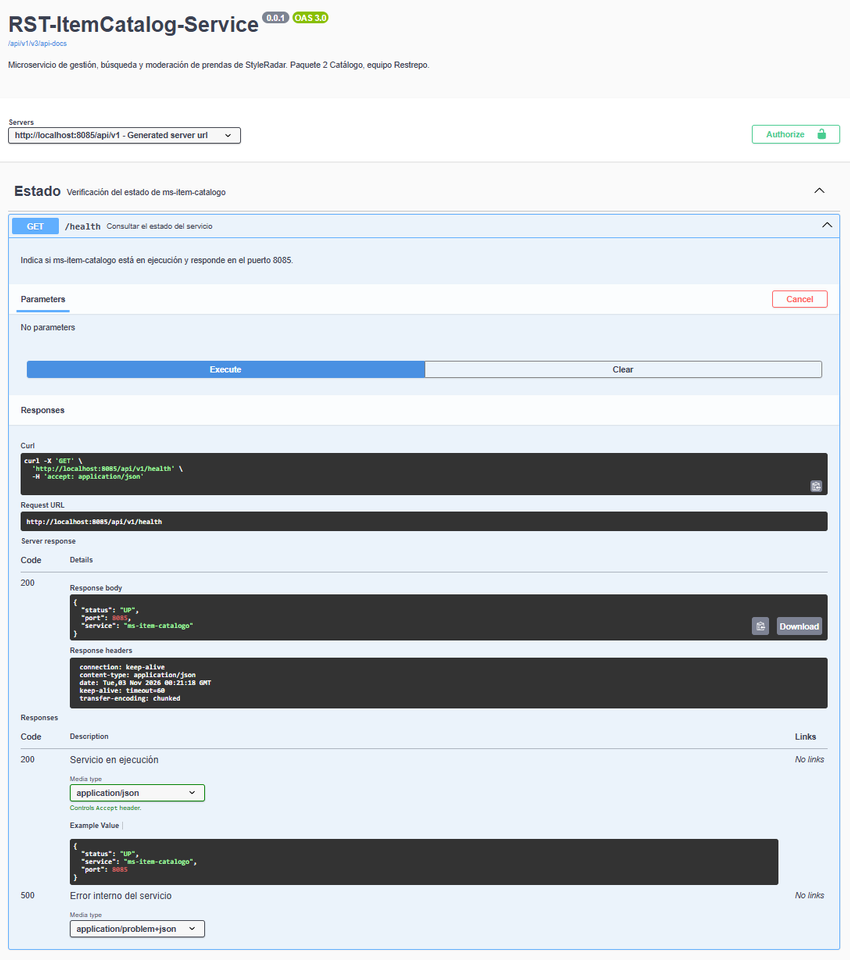

##  4. ENDPOINTS Y ENLACE A SWAGGER

### Matriz Oficial de Enlaces por Entorno (PROD, QA, LOCAL)

| Entorno | Estado | Propósito | URL Base del Servicio | Swagger OpenAPI UI | Health Check |
| :--- | :---: | :--- | :--- | :--- | :--- |
| **Producción (PROD)** | Desplegado | Despliegue productivo de StyleRadar | `https://rst-itemcatalog-service-prod.redwave-74d6e30f.northcentralus.azurecontainerapps.io/api/v1` | [Swagger UI PROD](https://rst-itemcatalog-service-prod.redwave-74d6e30f.northcentralus.azurecontainerapps.io/api/v1/swagger-ui/index.html) | [`/health`](https://rst-itemcatalog-service-prod.redwave-74d6e30f.northcentralus.azurecontainerapps.io/api/v1/health) |
| **Calidad / Pruebas (QA)** | Desplegado | Pruebas integradas del Sprint | `https://rst-itemcatalog-service-qa.redwave-74d6e30f.northcentralus.azurecontainerapps.io/api/v1` | [Swagger UI QA](https://rst-itemcatalog-service-qa.redwave-74d6e30f.northcentralus.azurecontainerapps.io/api/v1/swagger-ui/index.html) | [`/health`](https://rst-itemcatalog-service-qa.redwave-74d6e30f.northcentralus.azurecontainerapps.io/api/v1/health) |
| **Desarrollo Local (DEV)** | Local | Entorno de desarrollo local | `http://localhost:8220/api/v1` | [Swagger UI Local](http://localhost:8220/api/v1/swagger-ui.html) | [`/health`](http://localhost:8220/api/v1/health) |

* **Nota:** en QA y PROD el servicio se apaga por inactividad (Azure Container Apps), así que la primera petición puede tardar cerca de un minuto.
### Formato de los errores

Todos los errores responden `application/problem+json` (RFC 7807) con `type`, `title`, `status`, `detail`, `instance`, `code` y `timestamp` (ISO-8601); en los 400 de validación se agrega `errors` con el mensaje de cada campo.

| HTTP | `code` | Cuándo |
| :---: | :--- | :--- |
| 400 | `PARAMETRO_INVALIDO` | Falta un parámetro o tiene un formato inválido (por ejemplo un UUID mal escrito u `orden` inexistente) |
| 400 | `DATOS_INVALIDOS` | Un campo no cumple su validación o un valor no está en su lista; `errors` trae el mensaje de cada campo |
| 400 | `FOTOGRAFIAS_EXCEDIDAS` | Se envían más de 5 fotografías |
| 400 | `RANGO_PRECIO_INVALIDO` | `precioMin` es mayor que `precioMax` |
| 400 | `UBICACION_REQUERIDA` | Se pide `orden=DISTANCIA` sin `lat` o sin `lng` |
| 403 | `ACCESO_DENEGADO` | No es el almacén dueño ni un administrador, o intenta moderar sin ser `ADMIN_STYLERADAR` |
| 404 | `PRENDA_NO_ENCONTRADA` | La prenda no existe |
| 404 | `ALMACEN_NO_ENCONTRADO` | El almacén no existe |
| 404 | `ALMACEN_SIN_PENDIENTES` | El almacén no tiene publicaciones pendientes (moderación por grupos) |
| 404 | `RUTA_NO_ENCONTRADA` | La ruta no existe |
| 422 | `ALMACEN_SUSPENDIDO` | El almacén está suspendido y no puede publicar |
| 422 | `PRENDA_RETIRADA` | Se intenta editar una prenda retirada |
| 422 | `PRENDA_YA_RETIRADA` | Se intenta retirar dos veces |
| 422 | `PRENDA_NO_PENDIENTE` | Se intenta moderar una prenda que no está pendiente |
| 422 | `MOTIVO_REQUERIDO` | Se rechaza sin motivo |
| 500 | `ERROR_INTERNO` | Error inesperado o falla de ms-inventario o ms-geolocalizacion |

* **Especificación OpenAPI:** `http://localhost:8220/api/v1/v3/api-docs`

  <table width="100%" style="margin: 18px 0; border: 2px dashed #5600EF; border-radius: 8px; background-color: #FBFBFE;">
    <tr>
      <td align="center" style="padding: 22px;">
        

           
          <strong>DOCUMENTACIÓN SWAGGER OPENAPI UI ACTIVA</strong>
        

        

 
        

      </td>
    </tr>
  </table>

### Tabla de Endpoints Expuestos

El rol se lee de `X-User-Role` y `X-User-Roles`, que envía el API Gateway a partir del JWT. Se aceptan `STYLERADAR_ADMIN` (nombre actual de ms-auth), `ADMIN_STYLERADAR`, `ROLE_ADMIN_STYLERADAR` y `ADMIN` como administrador.

| Método | Endpoint | Descripción | Rol Requerido | Códigos HTTP |
| :---: | :--- | :--- | :--- | :---: |
| `GET` | `/api/v1/prendas` | Buscar prendas por texto libre con filtros opcionales (tipo, color, marca, estilo, talla y rango de precio) y ordenarlas por recientes, reputación o distancia con `lat` y `lng` (SR-RF-07 a 15; la talla se consulta en `ms-inventario`) | Público | `200`, `400` |
| `GET` | `/api/v1/prendas/{id}/similares` | Consultar prendas similares cuando no hay coincidencia exacta (SR-RF-16) | Público | `200`, `404` |
| `GET` | `/api/v1/prendas/{id}` | Consultar el detalle de una prenda | Público | `200`, `404` |
| `POST` | `/api/v1/prendas` | Publicar una prenda con fotografías, precio y atributos; queda pendiente de moderación; si llega `X-User-Id`, el almacén es el que el usuario administra en `ms-tiendas` (SR-RF-50, 51, 53 y 54) | `ADMIN_ALMACEN` | `201`, `400`, `404`, `422` |
| `PUT` | `/api/v1/prendas/{id}` | Editar una prenda y devolverla a moderación; el almacén sale de `X-Almacen-Id` o del usuario (`X-User-Id`) en `ms-tiendas` (SR-RF-55) | `ADMIN_ALMACEN` dueño, `ADMIN_STYLERADAR` | `200`, `400`, `403`, `404`, `422` |
| `DELETE` | `/api/v1/prendas/{id}` | Retirar una prenda del catálogo; el almacén sale de `X-Almacen-Id` o del usuario (`X-User-Id`) en `ms-tiendas` (SR-RF-58) | `ADMIN_ALMACEN` dueño, `ADMIN_STYLERADAR` | `200`, `403`, `404`, `422` |
| `PUT` | `/api/v1/prendas/{id}/moderacion` | Aprobar o rechazar una publicación; el rechazo exige motivo (SR-RF-61) | `ADMIN_STYLERADAR` | `200`, `400`, `403`, `404`, `422` |
| `GET` | `/api/v1/prendas/pendientes` | Consultar las publicaciones pendientes agrupadas por almacén (SR-RF-87) | `ADMIN_STYLERADAR` | `200`, `403` |
| `PUT` | `/api/v1/prendas/pendientes/almacenes/{almacenId}/moderacion` | Aprobar o rechazar todas las publicaciones pendientes de un almacén (SR-RF-87) | `ADMIN_STYLERADAR` | `200`, `400`, `403`, `404`, `422` |
| `GET` | `/api/v1/almacenes/{almacenId}/catalogo` | Consultar el catálogo de un almacén (SR-RF-22) | Público | `200`, `404` |
| `GET` | `/api/v1/almacenes/{almacenId}/catalogo/resumen` | Consultar el catálogo resumido para el mapa (SR-RF-19) | Público | `200`, `404` |
| `GET` | `/api/v1/almacenes/{almacenId}/novedades` | Consultar las prendas publicadas en los últimos 7 días (SR-RF-20) | Público | `200`, `404` |
| `GET` | `/api/v1/catalogo/items/{itemId}/disponibilidad` | Unidades totales y tallas con stock de una prenda, tomadas de `ms-inventario`; la usa `ms-notificaciones` (si inventario no tiene la prenda, `stockTotal` es 0) | Interno | `200`, `400`, `404` |
| `GET` | `/api/v1/catalogo/items/{itemId}/tallas-medidas` | Tallas ofertadas (`availableSizes`, las que tienen stock en `ms-inventario`; `[]` si no hay ninguna y `null` si inventario no tiene la prenda) y tabla de medidas (`sizes`, siempre `[]` porque el catálogo no guarda medidas en cm); la usa `ms-probador-virtual` (SR-RF-24 del probador) | Interno | `200`, `400`, `404` |
| `GET` | `/api/v1/health` | Estado del servicio | Público | `200` |

---

<a href="../README.md">⬅ Volver al índice</a>

