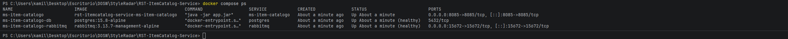

##  7. CÓMO EJECUTAR LOCAL Y CON DOCKER

### Prerrequisitos de Entorno

* **JDK:** 21
* **Apache Maven:** 3.9+
* **Docker Engine y Docker Compose**

### Ejecución Local con Maven (Perfil Dev)

Requiere PostgreSQL y RabbitMQ disponibles en las direcciones definidas en el archivo `.env`, creado a partir de `.env.example`.

```bash
git clone https://github.com/StyleRadar1/RST-ItemCatalog-Service.git
cd RST-ItemCatalog-Service
./mvnw spring-boot:run -Dspring-boot.run.profiles=dev
```

### Ejecución Contenerizada Completa con Docker

El servicio, junto con su base de datos y RabbitMQ, se levanta con Docker a partir del archivo `.env`:

```bash
docker compose up -d --build
```

### Comprobación de Salud (Health Check)

```bash
curl http://localhost:8220/api/v1/health
```

<div align="center">
  <table width="100%" style="margin: 18px 0; border: 2px dashed #5600EF; border-radius: 8px; background-color: #FBFBFE;">
    <tr>
      <td align="center" style="padding: 22px;">
        <p>
          <br />
          <strong><font color="#5600EF" size="3">CONTENEDOR OCI DOCKER EN EJECUCIÓN (docker compose ps)</font></strong>
        </p>
        <p>
<br />
        </p>
      </td>
    </tr>
  </table>
</div>

---

<p align="center"><a href="../README.md">⬅ Volver al índice</a></p>
