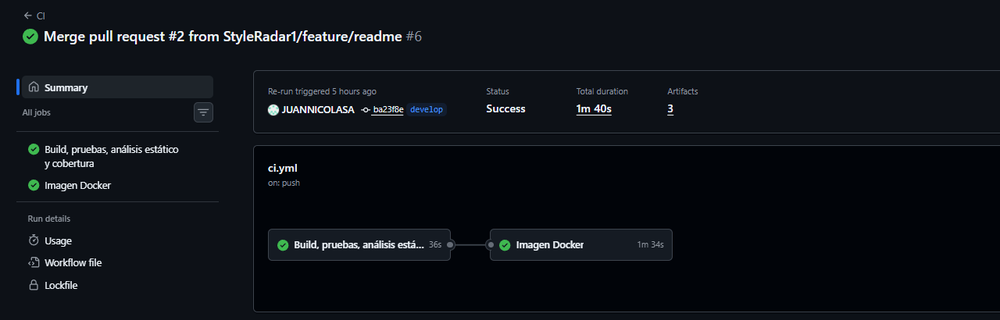

##  10. CI/CD CON EL BADGE DEL PIPELINE

Cada cambio enviado a `master`, `develop` o a una rama `feature/*`, así como cada pull request, pasa por un pipeline de **GitHub Actions** que compila el proyecto, ejecuta las pruebas, verifica la cobertura, realiza el análisis estático del código y construye la imagen Docker.

### Matriz de Pipelines por Rama Protegida

| Rama | Desencadenador | Etapas |
| :--- | :--- | :--- |
| `develop` | Push y pull request | Compilación, pruebas, cobertura, análisis estático e imagen Docker |
| `master` | Push y pull request | Compilación, pruebas, cobertura, análisis estático e imagen Docker |

### Diagrama del Flujo Automatizado (Pipeline Stages)

  <table width="100%" style="margin: 18px 0; border: 2px dashed #5600EF; border-radius: 8px; background-color: #FBFBFE;">
    <tr>
      <td align="center" style="padding: 22px;">
        

           
          <strong>EJECUCIÓN DEL PIPELINE CI/CD EN VERDE</strong>
        

        

 
        

      </td>
    </tr>
  </table>

---

<a href="../README.md">⬅ Volver al índice</a>

