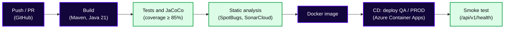
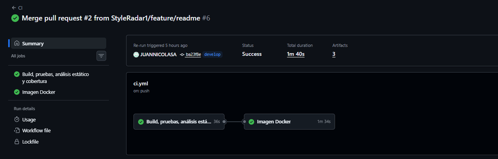

##  9. CI/CD CON EL BADGE DEL PIPELINE

Cada cambio enviado a `master`, `develop` o a una rama `feature/*`, así como cada pull request, pasa por un pipeline de **GitHub Actions** que compila el proyecto, ejecuta las pruebas, verifica la cobertura, realiza el análisis estático del código (SpotBugs y SonarCloud) y construye la imagen Docker.

Hay dos workflows con responsabilidades separadas:

* **`ci.yml` (validación):** compila, ejecuta las pruebas, verifica la cobertura con JaCoCo, analiza con SpotBugs y SonarCloud, publica el reporte de cobertura como artefacto y construye la imagen Docker. No despliega.
* **`cd.yml` (despliegue):** con un push a `develop` despliega en **QA** y con un push a `master` en **PROD** (Azure Container Apps); también se puede lanzar a mano eligiendo el ambiente. Construye y publica la imagen, crea la base de datos si no existe, despliega el contenedor y espera a que `GET /api/v1/health` responda antes de enviar tráfico (prueba de humo).

### Matriz de Pipelines por Rama Protegida

| Rama | Desencadenador | Etapas |
| :--- | :--- | :--- |
| `feature/**` | Push | `ci.yml`: compilación, pruebas, cobertura, análisis estático e imagen Docker |
| `develop` | Push y pull request | `ci.yml` y, al fusionar, `cd.yml` despliega en QA con verificación del health |
| `master` | Push y pull request | `ci.yml` y, al fusionar, `cd.yml` despliega en PROD con verificación del health |

### Diagrama del Flujo Automatizado (Pipeline Stages)

  <table width="100%" style="margin: 18px 0; border: 2px dashed #5600EF; border-radius: 8px; background-color: #FBFBFE;">
    <tr>
      <td align="center" style="padding: 22px;">
        

           
          <strong>EJECUCIÓN DEL PIPELINE CI/CD EN VERDE</strong>
        

        

 
        

      </td>
    </tr>
  </table>

---

<a href="../../README.md">⬅ Volver al índice</a>

