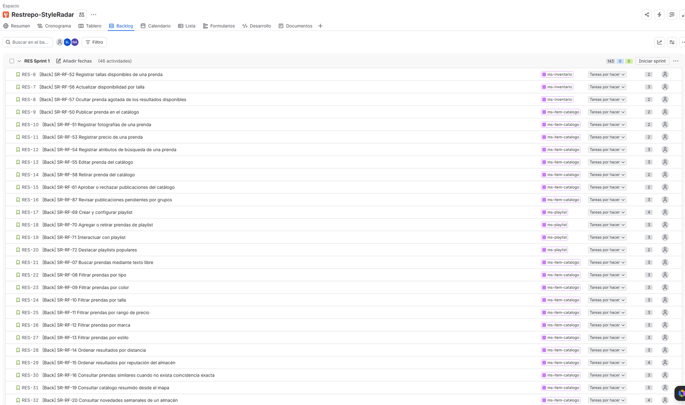

##  12. EQUIPO, RESPONSABLES Y ENLACE A LA ÉPICA EN JIRA

### Equipo y responsables

Desarrollado y mantenido por el **Equipo `Restrepo`** (prefijo `RST`) para la asignatura DOSW 2026.

| Rol | Nombre Completo | Usuario GitHub |
| :---: | :---: | :---: |
| **Líder y apoyo** | `Juan Nicolás Álvarez Muñoz` | [@JUANNICOLASA](https://github.com/JUANNICOLASA) |
| **Backend Developer** | `Daniel Mosquera` | [@Danielmmartinez](https://github.com/Danielmmartinez) |
| **Backend Developer** | `Sebastián Camilo Granados` | [@Sebastian-Granados1456](https://github.com/Sebastian-Granados1456) |
| **Frontend Developer** | `Carlos Sánchez` | [@Carlossj8](https://github.com/Carlossj8) |

### Enlaces de Gestión, Repositorios y Evidencias

* **Épica del Microservicio:** [RES-2 · ms-item-catalogo](https://mail-team-nyjtgqcj.atlassian.net/browse/RES-2)
* **Tablero del Equipo:** [Restrepo-StyleRadar (RES)](https://mail-team-nyjtgqcj.atlassian.net/jira/software/projects/RES/boards/76)

  <table width="100%" style="margin: 18px 0; border: 2px dashed #5600EF; border-radius: 8px; background-color: #FBFBFE;">
    <tr>
      <td align="center" style="padding: 22px;">
        

           
          <strong>TABLERO SCRUM Y SEGUIMIENTO DE LA ÉPICA EN JIRA</strong>
        

        

 
        

      </td>
    </tr>
  </table>

### Requerimientos Funcionales Asignados

| Código RF | Nombre del Requerimiento | Historia en Jira |
| :---: | :--- | :---: |
| `SR-RF-07` | Buscar prendas mediante texto libre | `RES-21` |
| `SR-RF-08` | Filtrar prendas por tipo | `RES-22` |
| `SR-RF-09` | Filtrar prendas por color | `RES-23` |
| `SR-RF-10` | Filtrar prendas por talla | `RES-24` |
| `SR-RF-11` | Filtrar prendas por rango de precio | `RES-25` |
| `SR-RF-12` | Filtrar prendas por marca | `RES-26` |
| `SR-RF-13` | Filtrar prendas por estilo | `RES-27` |
| `SR-RF-14` | Ordenar resultados por distancia | `RES-28` |
| `SR-RF-15` | Ordenar resultados por reputación del almacén | `RES-29` |
| `SR-RF-16` | Consultar prendas similares | `RES-30` |
| `SR-RF-19` | Consultar catálogo resumido desde el mapa | `RES-31` |
| `SR-RF-20` | Consultar novedades semanales de un almacén | `RES-32` |
| `SR-RF-22` | Consultar catálogo de almacén | `RES-33` |
| `SR-RF-50` | Publicar prenda en el catálogo | `RES-9` |
| `SR-RF-51` | Registrar fotografías de una prenda | `RES-10` |
| `SR-RF-53` | Registrar precio de una prenda | `RES-11` |
| `SR-RF-54` | Registrar atributos de búsqueda | `RES-12` |
| `SR-RF-55` | Editar prenda del catálogo | `RES-13` |
| `SR-RF-58` | Retirar prenda del catálogo | `RES-14` |
| `SR-RF-61` | Aprobar o rechazar publicaciones | `RES-15` |
| `SR-RF-87` | Revisar publicaciones pendientes por grupos | `RES-16` |

---

<a href="../../README.md">⬅ Volver al índice</a>

